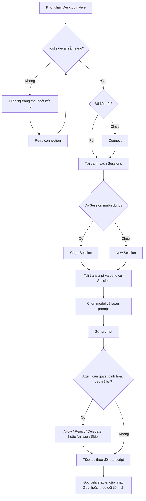
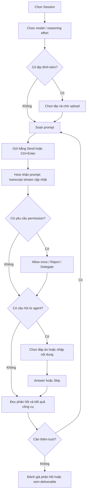
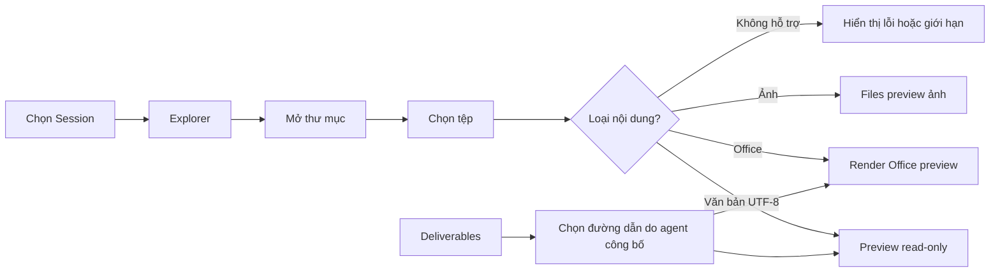
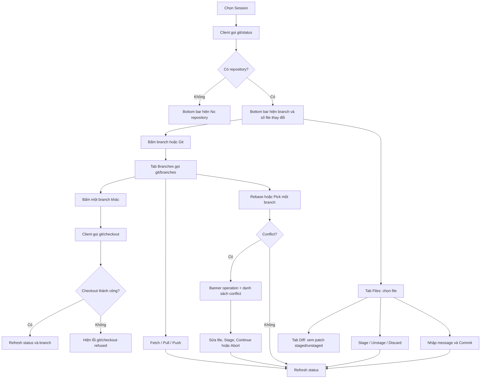
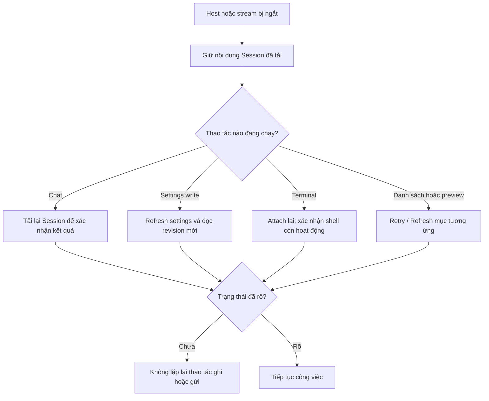

# User flow của ứng dụng Desktop native

## Tóm tắt

Tài liệu này mô tả hành trình người dùng từ lúc mở ứng dụng đến khi hoàn tất một Session, cùng các nhánh kết nối, quyền truy cập, preview tệp và khắc phục lỗi.

Ứng dụng được mô tả là client Rust/gpui đang chạy thật (`src/gpui_main.rs`, `src/shell/`); shell egui trong `src/main.rs` đã nghỉ. Các màn hình trong [`prototype/`](prototype/) chỉ mô phỏng một phần giao diện và không phải bằng chứng cho flow dưới đây.

## Mục lục

- [Luồng tổng thể](#luồng-tổng-thể)
- [Mở ứng dụng và bắt đầu Session](#mở-ứng-dụng-và-bắt-đầu-session)
- [Gửi prompt và xử lý tương tác](#gửi-prompt-và-xử-lý-tương-tác)
- [Đọc workspace và mở deliverable](#đọc-workspace-và-mở-deliverable)
- [Theo dõi công việc trong Session](#theo-dõi-công-việc-trong-session)
- [Chỉnh Settings và cập nhật](#chỉnh-settings-và-cập-nhật)
- [Xem Git và đổi branch](#xem-git-và-đổi-branch)
- [Ngắt kết nối và khôi phục](#ngắt-kết-nối-và-khôi-phục)

-----

## Luồng tổng thể

Luồng chuẩn bắt đầu bằng kết nối Host, sau đó người dùng mở hoặc tạo Session, gửi prompt và theo dõi phản hồi cùng các công cụ liên quan.

Ứng dụng có thể tự kết nối sau khi Host khởi động. Nếu không có cấu hình Host, thao tác tạo Session và các tính năng đọc/ghi cần Host không khả dụng. Chi tiết thao tác nằm trong [USER_GUIDE.md](USER_GUIDE.md).

-----

## Mở ứng dụng và bắt đầu Session

1. Người dùng khởi chạy bản Desktop native đã được phân phối.
2. Ứng dụng bắt đầu Host sidecar nếu gói cài đặt có cấu hình Host. Kết nối tự động được bật mặc định.
3. Nếu màn hình yêu cầu, người dùng chọn **Connect**. Ứng dụng xác thực với Host rồi tải Sessions và model catalog.
4. Khi **Restore last Session** bật, ứng dụng mở lại Session cuối và khôi phục bản nháp composer của Session đó. Nếu Session không còn, ứng dụng mở Session cập nhật gần nhất và nêu lý do trong danh sách Sessions.
5. Người dùng mở bộ chuyển Session (chip workspace, **Search ⌕**, hoặc tên Session ở đáy Explorer), rồi chọn một hàng để tải transcript; **＋** hoặc **New Session** tạo Session mới.
6. Sau khi tạo hoặc fork thành công, ứng dụng mở Session mới và làm mới danh sách.

| Nhánh | Kết quả hiển thị | Bước tiếp theo |
|---|---|---|
| Host chưa sẵn sàng hoặc bị ngắt | Banner Host disconnected; nút tạo Session không khả dụng | Chọn **Retry connection**; nếu Host không khởi động, liên hệ người quản trị. |
| Chưa có Session | Popover Session trống và nút **New Session** | Tạo Session để bắt đầu. |
| Tìm kiếm không có kết quả | Màn hình **No matching Sessions** | Xóa truy vấn hoặc nhập từ khóa khác. |
| Tải danh sách lỗi | Lỗi bên danh sách Sessions | Chọn Retry để tải lại; danh sách cũ được giữ khi refresh thất bại. |
| Provider chưa cấu hình | Có thể tạo Session nhưng Host chưa có model để xử lý prompt | Nhờ người quản trị cấu hình model provider rồi tải catalog lại. |

Đổi Session làm mới phạm vi Explorer, Goals, Terminal, Jobs và Schedules; bản nháp composer được giữ riêng và khôi phục khi quay lại. Transcript và deliverables của Session trước không được trộn với Session vừa chọn, và run đang chạy của Session cũ không bị hủy.

-----

## Gửi prompt và xử lý tương tác

1. Người dùng chọn model trong picker. Thay đổi áp dụng cho Session đang mở; model catalog và profile default do Host cung cấp.
2. Nếu cần tệp, chọn **Attach**, chọn tệp trên máy và chờ trạng thái upload hoàn tất. Tệp chưa upload xong thì chưa gửi được.
3. Người dùng nhập prompt rồi chọn **Send** hoặc nhấn **Ctrl+Enter**. Phản hồi assistant xuất hiện theo luồng; transcript cũng ghi các kết quả công cụ và sự kiện Session được hỗ trợ.
4. Nếu xuất hiện thẻ quyền, người dùng đọc công cụ và lý do trước khi chọn **Allow once**, **Reject** hoặc **Delegate**.
5. Nếu xuất hiện thẻ câu hỏi, người dùng chọn đáp án, có thể thêm nội dung riêng, rồi chọn **Answer**. **Skip** gửi câu trả lời rỗng.
6. Sau phản hồi, người dùng có thể đánh giá bằng 👍/👎, mở Deliverables, xem Jobs hoặc tiếp tục bằng prompt mới.

Nếu Host mất kết nối khi gửi, ứng dụng dừng theo dõi stream và yêu cầu tải lại Session để kiểm tra trạng thái trước khi thử lại. Không suy luận rằng yêu cầu đã thất bại chỉ từ việc stream bị ngắt.

-----

## Đọc workspace và mở deliverable

- **Explorer** tải cây thư mục thuộc Session, mở rộng thư mục theo yêu cầu và tải từng trang văn bản. Tất cả nội dung trong panel này là read-only.
- **Explorer** theo dõi thay đổi trên đĩa cho thư mục đang mở và tệp đang xem: thư mục đổi thì tải lại cây, tệp đổi thì báo phiên bản mới, tệp bị xóa thì giữ trang cuối kèm cảnh báo. Không có theo dõi thì panel báo và chờ bạn làm mới.
- **Files** nhận một đường dẫn Host hoặc đường dẫn từ Deliverables. Preview văn bản, ảnh và Office dùng đường xử lý tương ứng; Office preview hiển thị trang đầu tiên.
- **File actions > Open file…** cho phép chọn đường dẫn qua hộp thoại hệ điều hành rồi yêu cầu Host đọc đường dẫn đó trong phạm vi Session.
- **File actions > Save file…** lưu văn bản đang preview vào một đường dẫn cục bộ. Thao tác Save không ghi ngược nội dung vào workspace Host.

Nếu cây thư mục bị giới hạn, thư mục rỗng hoặc preview lỗi, giữ nguyên trạng thái được hiển thị và chọn refresh/retry phù hợp. Khi file đổi trong lúc đang đọc các trang kế tiếp, chọn lại file để bắt đầu preview mới.

-----

## Theo dõi công việc trong Session

Các tiện ích dưới cùng quan sát dữ liệu gắn với Session hiện tại; chọn biểu tượng để mở panel và chọn lại hoặc × để đóng panel.

| Mục | Hành trình người dùng | Kết quả hoặc giới hạn |
|---|---|---|
| Goals | Mở Goals, refresh, tạo hoặc chỉnh mục tiêu, pause/resume/complete/clear | Goal được Host lưu; Clear cần xác nhận và giữ lại lịch sử. |
| Plan mode | Chọn Enter plan mode hoặc Leave plan mode | Gửi `/plan` hoặc `/plan off` qua Host; nút bị khóa khi chat đang chạy. |
| Terminal | Refresh hoặc tạo terminal, chọn, Attach, nhập lệnh hoặc bật Raw keys, theo dõi output; Add pane mở thêm pane (tối đa 4), kéo vạch để đổi độ rộng, chọn dòng và Copy | Detach giữ shell sống; Close terminal kết thúc shell; pane detached giữ nguyên màn hình cuối để nối lại. |
| Jobs | Mở Jobs, refresh rồi chọn job | Hiển thị output và trạng thái; panel không cung cấp thao tác kill. |
| Schedules | Mở Schedules, refresh rồi chọn Delete nếu cần | Liệt kê/xóa lịch của Session; panel không tạo hoặc sửa lịch. |
| Deliverables | Mở Deliverables rồi chọn một đường dẫn | Chuyển sang Files preview cho tài liệu do agent công bố. |
| Skills | Mở Skills, lọc và chọn một skill | Hiển thị thông tin skill của Session; không cài đặt hoặc bật/tắt skill. |
| Plugins / Market | Xem inventory, tìm index, kiểm tra và cài bundle | Thay đổi plugin/profile do Host quản lý; xem USER_GUIDE.md để biết điều kiện từng mục. |

Chuyển sang Session khác sẽ tải lại hoặc xóa lựa chọn tiện ích để tránh thao tác nhầm phạm vi Session cũ.

-----

## Chỉnh Settings và cập nhật

1. Mở **Settings** từ menu **☰** → **Preferences…**, từ **Quick open** (Ctrl+P) hoặc bằng **Ctrl+,**.
2. Chỉnh Appearance, Layout, Shortcuts hoặc Advanced cho giao diện native.
3. Chọn **Preview changes** để áp dụng tạm hoặc **Save preferences** để lưu vào tệp cấu hình cục bộ.
4. Mở **Host settings** riêng nếu cần xem hoặc sửa user overrides do Host quản lý.
5. Nếu muốn kiểm tra phiên bản Desktop, mở **Desktop updates** và chọn **Check for updates** khi đã kết nối.
6. Khi Host hiển thị yêu cầu xác nhận, chọn Download/Install and restart hoặc Not now.

Appearance và Host settings có chủ sở hữu dữ liệu khác nhau. Lỗi ghi Host settings giữ bản nháp và yêu cầu refresh; xung đột không được tự gửi lại. Cập nhật Desktop được Host điều phối; ứng dụng hỏi người dùng trước các bước tải và cài đặt mà Host yêu cầu.

-----

## Xem Git và đổi branch

Mọi thao tác Git đều chạy trên Host; ứng dụng không tự chạy `git` trên máy desktop. Fetch/Pull/Push dùng credential helper và SSH agent của Host; Push luôn cần xác nhận lần hai và không bao giờ force. Pull chỉ fast-forward nên history diverge sẽ báo lỗi thay vì tạo merge commit. Rebase/Cherry-pick trả trạng thái conflict thật; người dùng sửa file, stage rồi Continue, hoặc Abort để quay lại HEAD trước đó. `Discard` chỉ áp dụng cho file đã track đang có thay đổi ở worktree; file untracked hoặc conflict bị từ chối và không bị xoá. Khi working tree dirty đến mức git từ chối đổi branch, thông báo lỗi của git hiện trong tab Branches và không có file nào bị ghi đè. Commit chỉ chạy khi có ít nhất một file staged; Host trả lỗi thật nếu git từ chối commit.

-----

## Ngắt kết nối và khôi phục

Khi Host mất kết nối, ứng dụng giữ phần Session đã tải để người dùng đọc nhưng các yêu cầu mới cần kết nối sẽ không chạy. Chọn **Retry connection** để xác thực lại. Sau khi kết nối, mở lại Session hoặc refresh panel liên quan để nạp trạng thái hiện tại từ Host.

Không tự gửi lại các thao tác có kết quả chưa rõ như gửi prompt, tạo/fork Session, cài plugin hoặc ghi Settings. Trước tiên tải lại dữ liệu tương ứng và xác nhận trạng thái phía Host.

Nếu cửa sổ biến mất khi bấm nút đóng, kiểm tra khay hệ thống: trên bản có tray, thao tác đóng chỉ ẩn cửa sổ. Chọn **Show/Hide** để hiện lại hoặc **Quit** để thoát.
