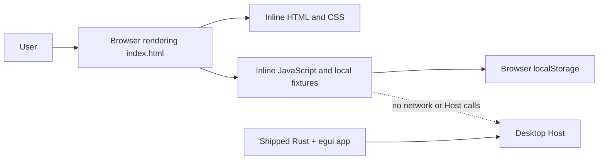

# Prototype architecture

## Scope and status

This project is a standalone browser-based prototype for the native desktop client. It demonstrates a target layout, screen set, and selected user-visible state transitions; it is not the shipped app, an API client, or a product contract.

The shipped app is the Rust + egui implementation in [`../../src/`](../../src/). The prototype’s `index.html` is deliberately self-contained and is not compiled, packaged, or loaded by that application.

## System context

The prototype runs entirely in one browser document. It stores only interface preferences in `localStorage`; session, transcript, model, workspace, plugin, marketplace, goal, job, schedule, terminal, and Host-setting data are local fixtures or temporary page state.

## Files and ownership

| File or area | Responsibility |
|---|---|
| [`../index.html`](../index.html) | Entry document; contains markup, style tokens, responsive rules, local state, fixture data, event handlers, and rendering functions. |
| [`../../src/`](../../src/) | Shipped native application. Product behavior and Host protocol changes belong here, not in the prototype. |
| [`interactions.md`](interactions.md) | Screen inventory, available interactions, simulated effects, and state-map fixtures. |

No JavaScript packages, build scripts, or server-side components are part of this prototype project.

## Document structure and layout

`<main class="app-window">` contains a title bar and a four-column workspace: navigation rail, Sessions sidebar, conversation/product area, and Workspace Explorer. A bottom utility strip selects Deliverables, Schedules, Jobs, and Terminal. A native HTML `<dialog>` hosts the State map and its layout previews.

The central area switches between the conversation, Settings, Document, Plugins, Skills, Marketplace, and Goals views. The Explorer has separate tree and read-only preview panes. The State map can apply fixtures to the main page or embed a fresh copy of the document in a sandboxed `iframe` for size-and-state previews.

The layout uses CSS Grid and custom properties. The default frame is 1440×900 CSS pixels with a 62-pixel rail, 278-pixel Sessions sidebar, and 390-pixel Explorer. The CSS breakpoints are 1240, 1120, 900, 820, and 680 pixels; the State map describes wide, compact, and narrow modes at >1240, 681–1240, and ≤680 pixels.

## Runtime layers

| Layer | Implementation | Owns |
|---|---|---|
| Bootstrap | Inline `<head>` script | Reads, validates, and applies saved UI preferences before first paint. |
| Presentation | Inline `<style>` and static HTML | Theme tokens, view markup, landmarks, control labels, and responsive layout. |
| Interaction | One inline `<script>` closure | DOM event handlers, temporary fixture state, fixture rendering, timers, and focus movement. |
| Preference storage | Browser `localStorage` | Theme mode, preset, scale, code-font choice, density, panel visibility, and widths. |
| Fixture data | Constants and DOM samples in `index.html` | Sample Sessions, transcript, model catalog, profile default, Explorer paths, product lists, Host document, and utility-panel content. |

The script caches DOM references, defines small rendering helpers, keeps related state in closure variables, and updates views in place. `renderChrome()` synchronizes the session empty state, Host banner, model picker, Explorer, preview, settings, and State map after fixture transitions.

## State ownership

`uiPrefs` contains preferences that can persist across browser reloads. The bootstrap validates values and clamps panel widths; `persistUiPrefs()` writes `dsh-ui-preferences` and the legacy `dsh-theme` key. If storage is unavailable, current-page changes still apply and the UI reports that persistence was unavailable.

`fx` contains scenario state for Sessions, Host, providers, Explorer tree, profile default, and Host settings. `scenario` supplies the outcome for the next simulated Host save, unknown-outcome check, reconnect, profile-default write, or catalog retry. `STATE`, `MAP`, and `PREVIEWS` map named fixtures to actions and layout previews.

Transcript rows, selected Session/model, attachments, local settings drafts, Explorer selection, timers, and utility-panel content live only in memory. Reloading discards those values and rebuilds the default fixture state, except for saved UI preferences.

## Main flows

### Load and preferences

The bootstrap reads stored preferences, validates enum values and numeric limits, applies the theme and layout CSS properties, then starts the main script. UI preference controls preview changes immediately; Save persists them, while Revert restores the last saved in-memory copy. The editable config view validates a JSON-with-comments example locally and never writes a file or Host setting.

### Session and composer

Selecting one of five seeded Sessions updates the active title; only “Refactor settings loader” has the full sample transcript, while the other rows show generic previews. Creating a Session adds a local row and empty transcript. Sending adds a user row, optionally adds attachment names, shows a pending row for 1.7 seconds, then inserts a canned local response. Cancel removes the pending response and inserts a local cancellation message. No prompt or file bytes leave the browser.

### Host and provider scenarios

The default Host state is `connected`, but the status copy labels it simulated. The State map can drive disconnect, retry, recovery, and terminal failure. Retry advances through timed local states and consumes the configured success/failure scenario. Provider catalog and profile-default states likewise use fixtures and timers; they do not ask a real Host or model provider.

### Explorer and file preview

The Explorer renders a fixed tree and a `FILES` map. Selecting a file changes the local preview state; timers illustrate loading, missing-file, truncated, binary, unsupported, blocked-path, and read-error outcomes. Source excerpts are embedded fixture lines; the preview never reads the repository or opens files from disk. The path traversal scenario is a visual fixture only.

### Host settings fixture

Host settings use a sample document and local revision numbers. Editing validates the sample JSON, and Save consumes a scenario for success/read-back, rejection, revision conflict, or unknown outcome. Conflict UI presents rebase, discard-and-load, or copy-draft actions; those actions mutate only the local fixture state.

## Failure and persistence semantics

Simulated errors describe intended presentation, not real transport outcomes. Reconnect attempts, catalog failures, settings conflicts, unknown save results, missing files, and blocked paths are produced by fixture state and timers. They do not test the actual Host’s retry, authentication, validation, transaction, or filesystem guarantees.

Only UI preferences have app-owned persistence semantics. The editable Host settings document, profile-default value, Session, transcript, goal, and utility data are resettable fixtures. Copying the settings draft may use the browser Clipboard API. The file picker only provides metadata for local attachment chips; the prototype does not read or upload selected bytes.

## Accessibility and responsive behavior

Markup uses labeled navigation, sections, buttons, status regions, dialog/tab patterns, tree roles, radio groups, and live transcript updates. The Explorer uses a roving tab stop and arrow-key tree navigation; the model picker supports arrow navigation and restores focus after rerender. The mobile Explorer becomes a sheet and makes the chat pane inert while open. CSS disables transitions and skeleton animation when reduced motion is requested.

These are implementation cues, not assistive-technology test results. No automated browser, screen-reader, or keyboard acceptance suite is included in this prototype project.

## Change locations

| Change | Primary location |
|---|---|
| Palette, typography, sizing, or breakpoint | Root CSS variables and media queries in [`../index.html`](../index.html). |
| Screen structure and labels | Static markup beginning at `<main class="app-window">`. |
| Local fixture state or transitions | Inline script state constants and relevant event/render functions. |
| State-map case or viewport preview | `STATE`, `MAP`, `SIZES`, and `PREVIEWS`. |
| Shipped behavior or Host integration | Rust implementation under [`../../src/`](../../src/), plus its tests; do not simulate product behavior in this HTML and describe it as shipped. |

Keep prototype docs under this project. Update repository-wide product documentation only when shipped behavior or verification changes.

## Known limits and open decisions

- The model picker, Session, terminal, plugin, marketplace, goal, schedule, job, attachment, and Host settings data are fixtures; they do not call product APIs.
- The example UI-config document is not the application’s persisted settings schema; the prototype labels the final schema as undecided.
- Several Explorer entries are placeholder, truncated, missing, or fabricated examples rather than source files in the repository.
- Whether each visual surface is intended to reach parity with the shipped app is not recorded here; use the interaction inventory and native implementation as separate references.
